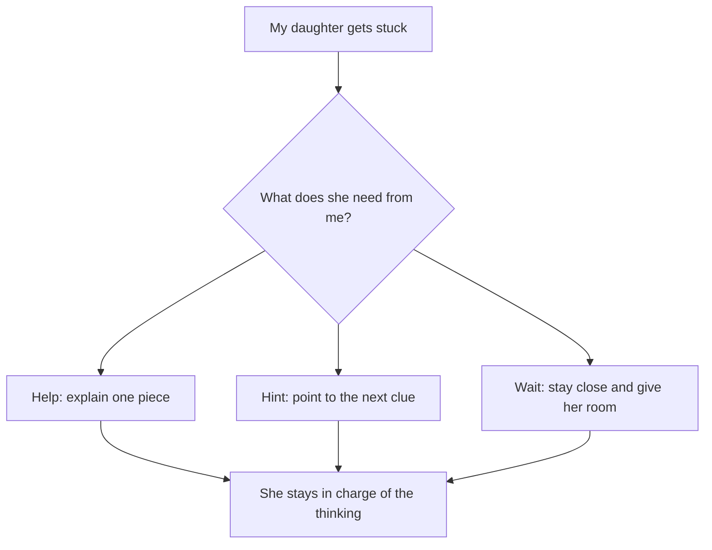

I'm a parent. I'm also a software engineer.

But this didn't start with software.

It started with watching my daughter struggle with math.

She's good at it. She understands the material. She can solve the problems. She can make connections.

And she still gets anxious.

I knew math anxiety in children was real. I just hadn't thought much about what it looked like when the child was actually good at math.

That's hard to watch as her dad.

I care about the answer, sure. But mostly I care about *her*. I don't want her to dread something she's good at. I don't want one hard problem to change the way she sees herself.

So when the anxiety shows up, my first instinct is to make it better.

I reassure her. I explain. I break the problem into smaller pieces. I point toward the next step.

Sometimes that helps.

Sometimes I can feel myself working harder on the problem than she is.

And that's when I started asking whether getting her to the answer was really the same as helping her.

There was the math problem in front of her.

Then there was everything that came with it.

What if I get it wrong?

Why is this taking me so long?

If I'm good at math, shouldn't this be easy?

The math hadn't changed. But now she had to work through all of that too.

This is the loop I started to see:

*A hard math problem can trigger worry. That worry leaves less room to think, which makes the problem feel even harder.*

## How a parent's help can add pressure

This is where I get stuck as a parent.

When I can see the next step, I want to point it out.

When she gets frustrated, I want to make the frustration go away.

When I know she can do it, I want to push her a little.

All of that feels like helping from my side of the table.

But what does it feel like from hers?

If I jump in too quickly, does she hear, “Dad doesn't think I can do this”?

If I keep pushing, does she hear, “The answer matters more than how this feels”?

If I say, “You're good at math,” does that make a hard problem feel even more threatening?

And if I say nothing, does she feel like she's on her own?

I don't have a neat answer for that.

I keep coming back to a smaller question:

**Do I help, hint, or wait?**

*Helping doesn't always mean giving the answer. Sometimes it means explaining one piece, offering a hint, or staying close while a child keeps trying.*

## Why math anxiety can make hard problems feel harder

I started reading about math anxiety because I wanted to understand how a kid could be good at math and still struggle this much with the feeling of doing it.

One idea clicked right away.

Think of working memory as the brain's scratch paper. It's where you hold the pieces of a problem while you work on it.

Now write “What if I get this wrong?” across half the page.

The math skill hasn't disappeared. There's just less room to use it.

In one study of first- and second-graders, math anxiety was most strongly connected to lower performance among kids with higher working-memory capacity, especially on harder problems. Even kids with strong mental tools had trouble using them when worry got in the way. ([Ramirez et al., 2013](https://sites.temple.edu/cognitionlearning/files/2013/09/Ramirez-et-al-2013.pdf))

That sounded a lot closer to what I was seeing.

Another review pulled together 84 study samples. It found that math anxiety and math performance are related, but they aren't the same thing. A child can have math ability and math anxiety at the same time. ([Zhang, Zhao, and Kong, 2019](https://doi.org/10.3389/fpsyg.2019.01613))

Then I started reading about what happens around the child.

Could my tone add pressure even when my words were encouraging? Could a teacher's reaction change how a mistake felt? Could watching other kids finish first make the anxiety worse?

A recent review looks at all of those layers—not just the child, but parents, teachers, peers, and the culture around math. ([Retanal and Maloney, 2026](https://doi.org/10.1038/s44159-025-00519-w))

That landed a little closer to home.

I couldn't tell my daughter to stop feeling anxious. But I could pay attention to what I brought into the room.

Was I calm?

Was I rushing her?

Was I doing more of the work than she was?

Was I treating “stuck” like an emergency?

## How parents can help a child with math anxiety

I used to think helping meant explaining more.

Now I'm trying to start with:

“What are you thinking?”

Or:

“Do you want a hint, or do you want another minute?”

Sometimes she needs an explanation.

Sometimes she needs one small clue.

Sometimes she needs time to try something that I can already see won't work.

And sometimes she needs me to stay calm while the problem feels hard.

There's research language for this: autonomy-supportive help.

In normal-person language, it means I stay available without grabbing the wheel. I can wait until help is needed, ask a question, offer a hint, or explain one piece while she stays in charge of solving the problem. ([Akhavein et al., 2025](https://doi.org/10.1002/icd.70061))

I am not great at this every time.

The engineer in me still likes fixing things.

But the goal isn't to make every hard feeling disappear. It's to help my daughter build a way through it.

## What my daughter's math anxiety taught me about learning

Once I saw this with math, I started seeing a much bigger question.

We spend a lot of time teaching kids answers.

What are we teaching them to do when they don't have one?

Can they notice when something doesn't fit?

Can they try another approach?

Can they ask for a clue without handing over the whole problem?

Can they explain what they're thinking?

Can they change their mind when the evidence changes?

Can they feel stuck without turning that feeling into “I can't do this”?

As a software engineer, I started wondering whether technology could help with those moments.

Not by giving a child the answer faster.

By helping them stay in the thinking.

That's the small experiment I've started working on. I'll share more about it soon.

For now, this is the idea I keep coming back to:

**Knowing the answer matters. So does knowing what to do when you don't know.**

## The questions I had as a parent

### Can a child be good at math and still have math anxiety?

Yes. That was the part I had trouble understanding at first. Math ability and math anxiety can exist at the same time. Worry can make it harder for a child to use skills they already have, especially on problems that need more mental effort.

### What can math anxiety look like in a child?

For us, it wasn't simply getting an answer wrong. It was the pressure around the answer: worrying about mistakes, feeling rushed, or treating one hard problem as evidence that she couldn't do math.

### How can a parent help with math anxiety?

I'm still learning. What helps me is asking what my daughter needs before I jump in. Does she want an explanation, one hint, another minute, or simply a calm person beside her? The goal is to support her without taking over the thinking.

---

## Research referenced

- Ramirez, G., Gunderson, E. A., Levine, S. C., & Beilock, S. L. (2013). [Math anxiety, working memory, and math achievement in early elementary school](https://sites.temple.edu/cognitionlearning/files/2013/09/Ramirez-et-al-2013.pdf).
- Zhang, J., Zhao, N., & Kong, Q. P. (2019). [The relationship between math anxiety and math performance: A meta-analytic investigation](https://doi.org/10.3389/fpsyg.2019.01613).
- Retanal, F., & Maloney, E. A. (2026). [Individual, interpersonal and sociocultural contributors to maths anxiety in children](https://doi.org/10.1038/s44159-025-00519-w).
- Akhavein, K., Griffin, M. K., & Finch, J. E. (2025). [The interplay between parenting behaviors and executive functions for children's math outcomes](https://doi.org/10.1002/icd.70061).
